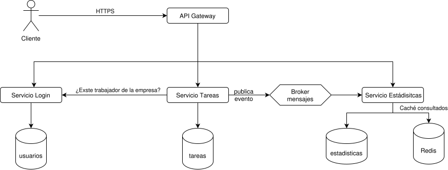

# Documentación hito 1

## Descripción del dominio

Para este proyecto se va a realizar una agenda de trabajo compartida entre el jefe y los trabajadores. En ella, el jefe crea, clasifica y asigna las tareas a sus trabajadores en un periodo de tiempo concreto. Además, el trabajador debe indicar cuando comenzó la tarea y cuando la finalizó. Todo ello, el sistema lo almacenará y podrá realizar estadísticas que ayuden al jefe a una mejora de la planificación.

Esta aplicación, ayuda a una empresa real, que ve ineficiente el reparto de tareas de forma verbal, además de que le gustaría digitalizarse. Asimismo, el jefe quiere saber qué tipo de tareas les cuesta más a los trabajadores o en cuales se suele producir más retraso, con el fin de realizar una mejor planificación.

Para facilitar el uso de usuarios del sistema, vamos a tener dos tipos:
- El administrador que cuyas funcionalidades están dirigidas al jefe de la empresa.
- El usuario que sus finalidades están dirigidas a los trabajadores.

### Casos de uso principales
| ID | Decripción | ACTOR |
| --- | --- | --- |
| CU-01 | Registrarse como empresa | Cualquiera |
| CU-02 | Iniciar sesión | Usuario registrado |
| CU-03 | Modificar los datos de mi usuario | Usuario registrado |
| CU-04 | Crear tipos de tareas | Administrador|
| CU-05 | Crear tareas |  Administrador |
| CU-06 | Modificar tareas | Administrador |
| CU-07 | Consultar mis tareas| Usuario |
| CU-08 | Marcar la tarea como iniciada | Usuario |
| CU-09 | Marcar la tarea como finalizada | Usuario |
| CU-08 | Ver estadísticas | Jefe |

### Justificación de porqué usar la nube
- La información sea acessible desde cualquier lugar y dispositivo.
- La carga es irregular, se concetrara en los horarios de trabajo.
- El pequeño negocio no puede o no quiern mantener sus propios servidores.

## Justificación del NIST
- **Autoservicio bajo demanda**: Una empresa nueva puede registrarse, crear su propio espcaico de trabajo y dar de alta a us trabajdores sin la intervención del proveedor. No hace falta instalar nada ni solicitar recursos a un administrador.
- **Agrupación de recusrsos**: Varias empresa comparten la misma infraestructura. Los datos se aislan lógiamente por un identificador de empresa prensente en todas las entidades y validado en cada petición. Los recursos se aisgna dinámicamente según la demanda, sin que el cliente conozca nada.
- **Rápida elasticidad**: La arquitectura de microservicios permite escalar cada servcio por separado, de esta forma, puede ser que el servicio de tareas tenga mayor necesidad de escaler a primera hora de la jornada, y en cambio la de estádisticas a final de la jornada.
- **Servicio medido**: EL uso de recusrso se monitoriza y se mide por empresa, lo que permite la facturación por uso ofereciendo transparecnia al proveedor y cliente.

# Mapeo de actores NIST
- **Consumidor**: La empresa cliente, tanto el jefe como sus trabajadores.
- **Proveedor**: El equipo de desarrollo de la aplicación  que operará sobre la infraestructura cloud (yo).
- **Intermediario**: Distribuidor que ofrezca el servicio a pequeños negocios (ficticio).
- **Auditor**: Quien nos evalúe la seguridad, privacidad y rendimiento (ficticio).
- **Operador**: Operador que conecte el cliente a la red para acceder al servicio.

# Diagrama de arquitectura
El diagrama de arquitectura es el que se muestra en la siguiente imagen:

Como podemos ver en el, el usuario, mediante un navegador o móvil, realiza funciones que generan peticiones. Estas peticiones las recibe el API Gateway el cual se encarga de validar el token y reenvía el mensaje al servicio correspondiente. De esta forma, cada servicio se encaarga de unas tareas en específico.

El servicio de login, se encarga de gestionar las empresas, usuarios y la autentificación al sistema. En cambio, el servicio de tareas se encarga de gestionar los tipos de tareas y las tareas y el servicio de estádisticas: de calcular y almacenar las estadísticas.

Como vemos en el diagrama, el servicio de tareas, se tiene que comunicar con el servicio de login, para asegurarse que por ejemplo un trabajdor asigando a una tarea exista y sea de la empresa. Además, el servicio de tareas, al cambiar el estado de una tarea (pausada, activa o finlizada) publica un evento en el broker para entregar el evento al servicio de estadisticas, el cual, actuliza su base de datos y calcula las estádisticas.

# Especificación de API REST

Comentar, que en todas las rutas que requieran saber el tipo de rol del sistema, deberán llevar en la cabecerá de la petición un token, para que el sistema sepa el rol y la empresa a la que pertenecen.

## Enpoints para el servicio de login/registro
| Método | Ruta | Descripción | Actores |
| --- | --- | --- | --- |
| POST | /api/auth/registro | Registra una nueva empresa y genera al usuario administrador | Cualquiera |
| POST | /api/auth/login | Inicia sesión de un usurio registrado | Administrador o trabajador |
| POST  | /api/auth/usuarios | Crea un nuevo usuario (trabajador) | Administrador |
| GET  | /api/auth/usuarios | Devuelve una lista con los usuarios de la empresa | Administrador |
| PUT | /api/auth/usuarios | Modificación de los datos asociciados al usuario personal | Administrador o Trabajador |

## Enpoints para el servicio de tareas
| Método | Ruta | Descripción | Actores |
| --- | --- | --- | --- |
| GET | /api/tipos-tareas | Devuelve el listado de tipos de tareas | Administador, trabajador |
| POST | /api/tipos-tareas | Crea un nuevo tipo de tarea | Administrador |
| GET | /api/tareas | Devuelve las tareas asociadas o todas dependiendo del tipo de usuario | Administador, trabajador |
| GET  | /api/tareas/{id} | Devuelve la información de una tarea | Administrador, trabajador |
| DELETE  | /api/tareas/{id} | Eliminiar una tarea cread | Administrador |
| POST | /api/tareas | Crea una nueva tarea | Administrador |
| PATCH | /api/tareas/{id} | Modifica una tarea | Administrador |
| POST  | /api/tareas/{id}/iniciar | Inicia una tarea | Administrador, trabajador |
| POST | /api/tareas/{id}/fin | Finaliza una tarea | Administrador, trabajador |
| POST  | /api/tareas/{id}/reiniciar | Reinicia una tarea | Administrador, trabajador |
| POST | /api/tareas/{id}/pausar | Pausar una tarea | Administrador, trabajador |

## Enpoints para el servicio de estádisticas
| Método | Ruta | Descripción | Actores |
| --- | --- | --- | --- |
| GET | /api/estadisticas/resumen | Devuelve estadísticas de un periodod de tiempo | Administador |
| GET | /api/estadisiticas/tipos | Deveulve el tiempo medio y número de tareas por tipo | Administrador |
| GET | /api/tareas | Devuelve lla carga y el rendimiento de un trabajador | Administador |

